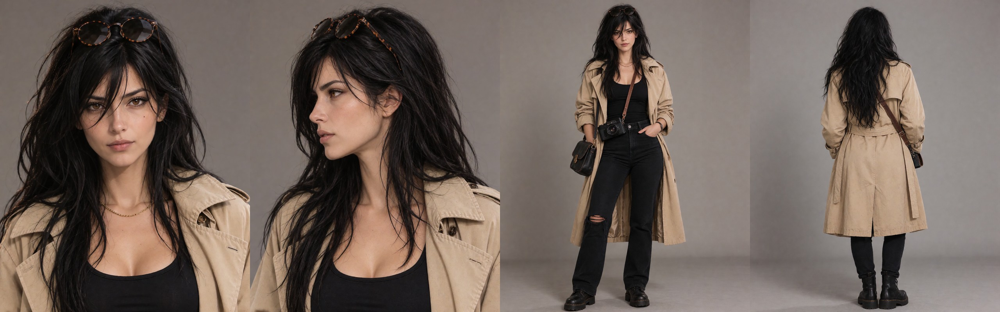

# Nora Ferraz

> I ask twice before I write a line.

Freelance journalist in Rio. She sells finished stories to whoever pays and shoots what she reports on film: thirty-six frames a roll, counted. She won't waste one on a photo you'll ask her to delete.

## Talk to her

`card.png` is the whole character: drop it into SillyTavern, RisuAI, Chub or any frontend that imports Tavern cards. It carries Character Card V3 and V2 in the same file, so older apps read it too. `card.json` is the same card as plain JSON, for the apps that ask for a file instead of an image.

Three openings: a rainy awning in Lapa, a darkroom the size of a closet, a Sunday corner bar.

## Draw her

Her face is a LoRA: [Nora Ferraz on Civitai](https://civitai.com/models/3028183).

| | |
|---|---|
| Base | Krea 2 |
| Trigger | `norasint` |
| Weight | 1.0 |
| Tested on | Krea 2 Turbo, 10 steps, CFG 1, Euler, 1024x1280 |

- The hair and the mole come on their own. The sunglasses don't: ask for them.
- Ask for the expression. Without one, you get her work face.
- Neon, shop signs and book covers can spell the trigger. Write the text you want there.
- In a crowd, people behind her can end up with her hair and her dress. Describe who else is there.

`lora.json` has the same data for scripts.

## What is in the folder

| File | What it is |
|---|---|
| `card.png` | The character card, V3 and V2 embedded |
| `card.json` | The card as JSON (V3) |
| `sheet.jpg` | Reference sheet: front, profile, full body, back |
| `reference/` | The four sheet images at full size, in her everyday look |
| `poses/` | Thirty-one scenes from her life, made with the LoRA alone (list below) |
| `expressions/` | The 28 expression sprites, named the way SillyTavern expects. All of them are Nora under that awning, the night the first greeting happens |
| `lora.json` | Model page, trigger, weight and tested settings |

Every PNG in `poses/`, `reference/` and `expressions/` keeps its prompt, seed and settings inside the file. Open one in any metadata reader, or drop it on Civitai, and you get the exact recipe.

## Her life, in `poses/`

Not a photoshoot. A week. Her hair goes up, gets wet, gets braided.

- **Work:** the awning in Lapa, the shot from chest height, the darkroom, loading film by touch, the phone and the notebook, the smile when someone corrects themselves, the Sunday corner bar, the steps in Santa Teresa, a deadline with a pencil in her bun, the morning her story ran cut.
- **Care:** wet hair and coffee after the shower, mascara before going out, the toothbrush and the morning paper, the salon chair.
- **Food:** a pastel at the street market, rice and beans at midnight, washing glasses in the kitchen at the party, a coconut at the kiosk.
- **Friends:** the bar table, the rooftop at sunset, a samba night, two braids and a hug.
- **Around town:** the bicycle on the waterfront, caught in the rain, the moto-taxi, the ferry across the bay, the waiting room she hates.
- **Off duty:** the hammock and a book, a white shirt at the window, a night out, Sunday morning in bed.

To use the sprites in SillyTavern, copy `expressions/` to `data/default-user/characters/Nora Ferraz/` and turn on Character Expressions.

Original character. Dressed by Aria Maiven.
